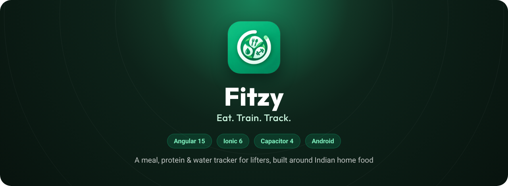
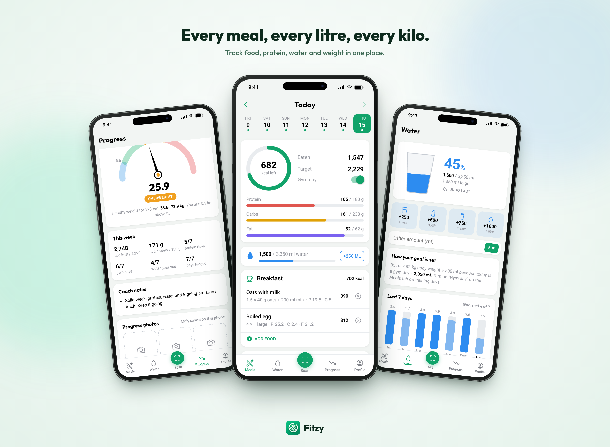
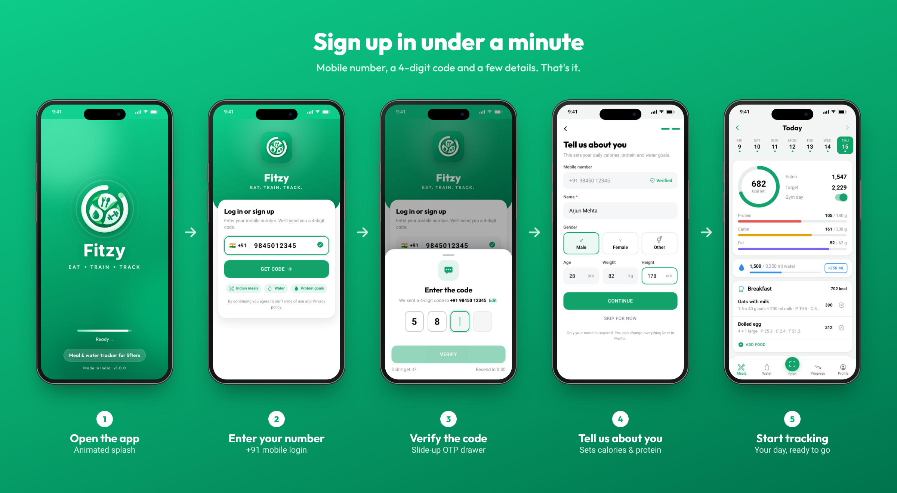
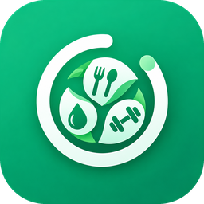

<div align="center">



<br />


**Count your roti, dal and whey. Hit your protein. Drink enough water. Watch the trend, not the scale.**

[Features](#features) · [Screens](#screens) · [How targets work](#how-your-targets-are-worked-out) · [Run it](#run-it) · [Roadmap](#roadmap)

</div>

<br />

<p align="center">
  
</p>

## Why Fitzy

Most calorie apps are built for burgers and bagels. Fitzy is built for people who train and eat **idli-sambar for breakfast, roti-dal-sabzi for lunch and a whey shake after the gym**. It turns your body details into clear daily targets, makes logging a meal a two-tap job, and shows whether the week is actually working.

## Features

| Feature | What it does |
|---|---|
| 🍛 **Meals** | Day strip, calorie ring, protein / carb / fat bars, 46 built-in Indian and gym foods in home-style portions, custom foods, "copy the day before" |
| 🎯 **Targets** | Calories from the Mifflin–St Jeor formula, your activity level and goal (lose fat, maintain, build muscle); protein set in g per kg |
| 💧 **Water** | Goal of 35 ml per kg, +500 ml on gym days; one-tap glass, bottle and shaker; 7-day chart |
| 📈 **Progress** | Weigh-ins with a 7-day average trend line, weekly summary, coach notes, front / side / back progress photos |
| ⚖️ **BMI gauge** | Half-circle gauge with WHO bands and the healthy weight range for your height |
| 🔐 **Sign-in** | Mobile number + one-time code in a slide-up drawer, then a short "about you" step |
| 👤 **Profile** | Photo, diet preference (veg / eggetarian filters food search), light or dark theme, data backup |
| 📱 **Private** | Everything is stored on the phone; nothing is uploaded |

<p align="center">
  
</p>

## How your targets are worked out

| What | Formula |
|---|---|
| Resting burn (BMR) | Mifflin–St Jeor: `10 × kg + 6.25 × cm − 5 × age`, then `+5` for men, `−161` for women, `−78` for other |
| Maintenance (TDEE) | `BMR × activity` (1.2 desk job → 1.9 hard training + physical job) |
| Daily calories | Maintenance `−20%` to lose fat, `+10%` to build muscle; never below 1,500 kcal (men) or 1,200 kcal |
| Protein | `kg × g per kg` (default 2.2 cutting, 1.8 maintaining, 2.0 bulking) |
| Fat / carbs | Fat 25% of calories (at least 0.6 g per kg); carbs fill the rest |
| Water | `35 ml × kg`, `+500 ml` on gym days |
| BMI | `kg ÷ m²`; WHO bands: under 18.5, 18.5–24.9 healthy, 25–29.9 overweight, 30+ obese |

For example, a 28-year-old man at 178 cm and 82 kg who trains 3–5 days a week and wants to lose fat gets **2,229 kcal and 180 g protein a day**, and a water goal of **3.35 L** on gym days.

## Run it

You need Node.js 16 or 18 (Angular 15 supports Node 14.20, 16 and 18).

```bash
git clone https://github.com/PaVaN1063/Fitzy.git
cd Fitzy
npm install
npx ionic serve        # opens http://localhost:8100
```

On Android:

```bash
npx ionic build
npx cap sync android
npx cap open android   # build and run from Android Studio
```

The app ID is `com.fitzy.app`.

## Project layout

```
src/app/
├── core/        data model, nutrition formulas, dates, storage, sign-in
├── shared/      calorie ring, macro bars, BMI gauge, food search sheet
├── splash/      animated launch screen
├── login/       mobile number, OTP drawer, about-you step
├── tabs/        bottom navigation
├── today/       Meals
├── water/       Water
├── scan/        product scan
├── progress/    weight trend, BMI, weekly summary, photos
├── profile/     profile, edit profile, help and policy pages
└── targets/     body and goals calculator
resources/       logo source and icon masters
docs/            README images
```

## Roadmap

- [x] Meals, targets, water, progress and profile
- [x] Mobile number sign-in with an "about you" step
- [x] BMI gauge, progress photos, dark theme
- [ ] Send the OTP by SMS (any 4-digit code is accepted for now, see `core/auth.service.ts`)
- [ ] Reminder notifications with `@capacitor/local-notifications` (switches save the choice today)
- [ ] Real product recognition with ML Kit barcode scanning or a vision API (`scan/scan.page.ts`)
- [ ] Cloud sync and backup
- [ ] iOS build

New accounts start with two weeks of history fitted to the person's own targets, so every screen is filled in. Set `SEED_HISTORY = false` in `src/app/core/tracker.service.ts` to start empty.

## Credits

- Fonts: [Outfit](https://fonts.google.com/specimen/Outfit) (SIL Open Font License, bundled in `src/assets/fonts`) and Roboto
- Icons: [Ionicons](https://ionic.io/ionicons)
- Food values: approximate, for home-style portions

## Copyright

© 2026 Pavan Kumar Naraharisetti. All rights reserved.

The code is public so that anyone can see how the app is built. The code,
design, the Fitzy name and the logo may not be copied, reused or published
without my written permission. See [LICENSE](LICENSE) for details.

Trek photos, organiser names and people in the app are sample content for
demonstration only.

If you'd like to use something from this project or work on it together,
reach out on [GitHub](https://github.com/PaVaN1063).


<div align="center">
<br />


**Fitzy** · made in India by [Pavan Kumar Naraharisetti](https://github.com/PaVaN1063)

</div>
